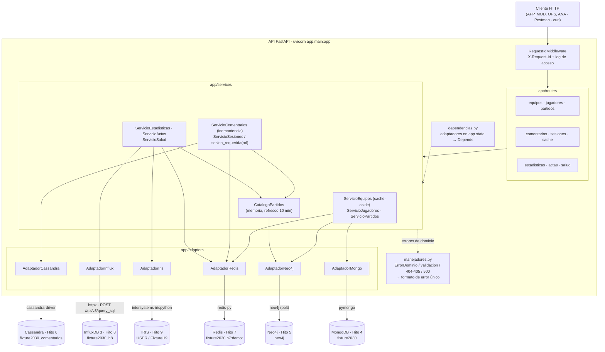

# Hito 10 · Arquitectura y adaptadores

Grupo 13 · Ingeniería de Datos II · Fixture Mundial 2030

Este documento describe cómo está construida la API **tal como está en el código** de `Hito 10/app/`. Cubre los apartados *Arquitectura*, *Adaptadores* y *Coherencia con el TPO* de la sección 8 del enunciado. Los casos de uso (CU-01…CU-20) y sus reglas están en [`casos_de_uso.md`](casos_de_uso.md); el mapa de endpoints y los errores, en [`contratos_y_errores.md`](contratos_y_errores.md).

## 1. Capas

La API es una aplicación FastAPI (Python 3.13, Pydantic v2) con cuatro capas y una regla de dependencia estricta: cada capa solo conoce a la de abajo, y **ningún tipo de un driver sale de su adaptador**.

| Capa | Carpeta | Responsabilidad | Qué no hace |
|---|---|---|---|
| Rutas (controladores HTTP) | `app/routes/` (un router por módulo: `equipos`, `jugadores`, `partidos`, `comentarios`, `sesiones`, `cache`, `estadisticas`, `actas`, `salud`) | Declarar método, ruta, parámetros, encabezados y cuerpo con tipos de Pydantic (la validación de formato ocurre acá, antes de cualquier consulta); declarar las respuestas para OpenAPI; llamar a un servicio; fijar encabezados de respuesta (`X-Cache`). | No importan drivers ni construyen consultas. |
| Servicios (casos de uso) | `app/services/` | Reglas del caso de uso: validaciones que Pydantic no cubre (`desde < hasta`, ventanas máximas, modos excluyentes), cache-aside, sesión y rol antes de escribir, idempotencia, catálogo de partidos, ensamblado de la respuesta. | No conocen drivers: definen lo que necesitan como `Protocol` (`RepositorioEquipos`, `CacheFichas`, `RepositorioComentarios`, `RegistroIdempotencia`, `RepositorioActas`…) y reciben el adaptador por inyección. |
| Adaptadores | `app/adapters/` (`mongo_`, `neo4j_`, `cassandra_`, `redis_`, `influx_`, `iris_adaptador.py`) | Conexión, contexto (db/keyspace/namespace/prefijo), consultas fijas y parametrizadas, conversión a `dict` con identificadores de negocio y fechas UTC, traducción de excepciones a `app/errors.py`, log por operación y cierre de recursos. | No conocen HTTP ni reglas de negocio. |
| Transversal | `app/main.py`, `app/middleware.py`, `app/manejadores.py`, `app/errors.py`, `app/config/`, `app/dependencias.py`, `app/openapi.py`, `app/schemas/` | Arranque y ciclo de vida, `X-Request-Id`, formato de error único, configuración desde entorno, proveedores de adaptadores para `Depends`, contrato OpenAPI, modelos de request/response. | — |

### 1.1 Diagrama

### 1.2 Inyección de dependencias

- `create_app()` (`app/main.py`) crea **una instancia por adaptador** en el `lifespan` y la guarda en `app.state`; al apagar, detiene el catálogo y llama a `cerrar()` de cada adaptador.
- `app/dependencias.py` expone `obtener_adaptador_<fuente>(request)` y `obtener_catalogo_partidos(request)`. Cada servicio tiene un proveedor `obtener_servicio_<modulo>` que recibe esos adaptadores con `Depends`.
- Las pruebas unitarias reemplazan esos proveedores con `app.dependency_overrides` y adaptadores falsos de `tests/falsos.py` (ver [`pruebas_y_evidencia.md`](pruebas_y_evidencia.md)). Así se prueban rutas y servicios sin Docker.
- Las rutas son síncronas (`def`): los drivers son bloqueantes y FastAPI las ejecuta en su threadpool.

### 1.3 Arranque con fuentes caídas

Ningún adaptador consulta su base al crearse, así que la API **arranca aunque una fuente esté detenida** y la falla aparece como 503 en la primera request que la usa:

| Adaptador | Cuándo conecta |
|---|---|
| MongoDB | `MongoClient` conecta en segundo plano. |
| Neo4j | El driver conecta en la primera consulta. El catálogo de partidos intenta cargarse al iniciar; si Neo4j no responde, queda `no_cargado` (§1.5). |
| Cassandra | `Cluster.connect()` en el primer uso, con lock; si falla, se apaga el `Cluster` y el próximo uso crea otro. |
| Redis | El cliente conecta al primer comando. |
| InfluxDB | El cliente HTTP no conecta al crearse, pero **lee el token del archivo de `INFLUX_TOKEN_FILE`**: si falta el archivo, la API no arranca y el mensaje nombra la variable. |
| IRIS | Conecta en el primer uso; ante una falla de comunicación descarta la conexión y la próxima request reconecta. |

La única excepción deliberada es la configuración: si falta una variable obligatoria (usuarios, contraseñas, ruta del token), `cargar_settings()` corta el arranque con un mensaje que nombra la variable y nunca su valor (ver [`conectividad_y_configuracion.md`](conectividad_y_configuracion.md)).

### 1.4 Observabilidad (RF18, RNF10)

- `RequestIdMiddleware` (ASGI puro) acepta el `X-Request-Id` del cliente si es un UUID válido; si no, genera uno. Lo guarda en un `ContextVar` (`app/config/logging.py`) y lo devuelve en el encabezado de **toda** respuesta, incluidas las de error.
- Todas las líneas del logger `app` llevan `request_id=<uuid>` gracias a `FiltroRequestId`. Hay tres niveles de línea para la misma request:
  - acceso (`app.acceso`): `metodo=… ruta=… estado=… duracion_ms=…`;
  - adaptador (`app.adapters.<fuente>`): `dependencia=… operacion=… resultado=… duracion_ms=…`, con `resultado=ok`, `DEPENDENCIA_NO_DISPONIBLE`, `DEPENDENCIA_TIMEOUT` o `ERROR_INTERNO tipo=<clase>`;
  - errores (`app.errores`): `dependencia=… resultado=…` para 503/504 y el stack trace completo para un 500 no previsto.
- La marca de tiempo de cada línea es la hora local de la máquina, sin zona (formato por defecto de `logging`); las fechas de las respuestas sí van en UTC.
- No se registran encabezados (el `X-Session-Id` es una credencial), la query string, los cuerpos, ni el texto de Cypher/CQL/SQL, sus parámetros o el mensaje crudo del driver. Neo4j tiene además las notificaciones del servidor apagadas, porque incluyen el texto del Cypher.

Evidencia: `docs/evidencia/api_correlacion_request_id.txt`.

### 1.5 Catálogo de partidos en memoria

`app/services/catalogo_partidos.py` implementa la decisión de `casos_de_uso.md` §3.2:

- Carga al iniciar con una consulta fija de `AdaptadorNeo4j.cargar_catalogo_partidos()` (`partidoId` → equipos que lo disputan, con `LIMIT 1000`).
- Un hilo daemon la refresca cada `CATALOGO_REFRESCO_S` (600 s). Si un refresco falla, conserva el catálogo anterior y lo registra (`catalogo=no_actualizado`).
- Si nunca cargó, las operaciones que lo necesitan (CU-08, CU-09, CU-20, CU-15, CU-16, CU-17) reintentan como máximo una vez cada `CATALOGO_REINTENTO_S` (30 s) y, mientras tanto, responden `503 DEPENDENCIA_NO_DISPONIBLE`, nunca 200 ni 404.
- `GET /api/v1/salud` informa `estado`, `partidos` y `ultimaCarga` sin forzar una recarga.

Comprobado en `docs/evidencia/neo4j_lista_de_control.txt`: con Neo4j detenido, CU-05/06/07 responden 503 y CU-08 sigue respondiendo 200 con el catálogo ya cargado.

## 2. Adaptadores

Todos siguen el mismo esqueleto: constructor que recibe `Settings` (y opcionalmente un cliente o sesión falsa para las pruebas), sentencias definidas como constantes del módulo, un context manager `_traducir` / `_operar` que convierte excepciones y registra la operación, métodos públicos que devuelven `dict`/`list[dict]` o `None` para “no existe”, `ping()` para la salud y `cerrar()`.

### 2.1 MongoDB · `app/adapters/mongo_adaptador.py`

| Aspecto | Implementación |
|---|---|
| Conexión | `MongoClient(host, port, username, password, authSource)` con `serverSelectionTimeoutMS` = `connectTimeoutMS` = 2 s y `socketTimeoutMS` = 3 s. |
| Contexto | `cliente[MONGO_DB]` (`fixture2030`), colecciones `equipos` y `jugadores`. |
| Operaciones | `obtener_equipo` (Q01, índice `uq_equipos_equipoId`), `existe_equipo` (proyección `{_id:1}`, para distinguir 404 de plantel vacío), `listar_equipos` (Q03, `idx_equipos_confederacion_ranking`, orden `rankingReferencia, equipoId`, `skip/limit`), `listar_jugadores_de_equipo` (Q06/Q07, `idx_jugadores_equipo_nombre`, orden `apellido, nombre, jugadorId`), `obtener_jugador` (Q02). |
| Conversión | Proyecciones fijas que excluyen `_id`, `origen`, `esDatoSintetico`, `creadoEn`, `actualizadoEn`. |
| Errores | `NetworkTimeout`, `ExecutionTimeout` → `DependenciaTimeout` (504); `ConnectionFailure` (incluye `ServerSelectionTimeoutError`) → `DependenciaNoDisponible` (503); otro `PyMongoError` (p. ej. autenticación) → `ErrorDominio` (500, tipo solo en el log). |

### 2.2 Neo4j · `app/adapters/neo4j_adaptador.py`

| Aspecto | Implementación |
|---|---|
| Conexión | `GraphDatabase.driver(NEO4J_URI, auth)` con `connection_timeout` y `connection_acquisition_timeout` = 2 s; notificaciones del servidor apagadas. |
| Contexto | Sesiones con `database=NEO4J_DATABASE` (`neo4j`) y `READ_ACCESS`; cada consulta es una transacción con timeout de 3 s (`NEO4J_TX_TIMEOUT_S`). |
| Operaciones | Cuatro Cypher fijos (`Query`) con parámetros `$equipoId`, `$partidoId`, `$desde`, `$hasta`, `$estadioId`, `$limite`: `AGENDA_EQUIPO` (Hito 5 Q04 + Q06), `EVENTOS_PARTIDO` (Q07), `PARTIDOS_POR_FECHA` (Q09, índice `idx_partido_inicio`) y `CATALOGO_PARTIDOS`. Todos con `LIMIT`. Las dos primeras hacen `MATCH` del nodo raíz y luego `OPTIONAL MATCH` del recorrido, de modo que el adaptador devuelve `None` (→ 404) si el nodo no existe y `[]` si existe sin resultados. |
| Conversión | Solo propiedades: nunca nodos, relaciones ni element ids. `neo4j.time.DateTime` → `datetime` UTC. **No se proyecta `Partido.estado`** (el estado pertenece a IRIS, `casos_de_uso.md` §3.1). |
| Errores | `ServiceUnavailable`, `SessionExpired` → 503; `Neo4jError` de timeout de transacción → 504; otro `Neo4jError` (autenticación, sintaxis) o `DriverError` → 500. |

### 2.3 Cassandra · `app/adapters/cassandra_adaptador.py`

| Aspecto | Implementación |
|---|---|
| Conexión | `Cluster` con `connection_class=AsyncioConnection` (Python 3.12+ no trae `asyncore`), `TokenAwarePolicy(DCAwareRoundRobinPolicy(CASSANDRA_DC))`, `FallthroughRetryPolicy` (sin reintentos implícitos), `ConsistencyLevel.ONE`, `request_timeout` = 2 s, `connect_timeout` = 2 s; autenticación solo si hay usuario y contraseña. |
| Contexto | `cluster.connect(CASSANDRA_KEYSPACE)` (`fixture2030_comentarios`). |
| Operaciones | Sentencias **preparadas** y fijas sobre las dos tablas del Hito 6: lectura por `(partido_id, minuto, segmento)` con `IN` sobre los 4 segmentos y `PER PARTITION LIMIT` (Q1 y Q2), lectura por `(usuario_id, dia)` (Q3), lectura por clave primaria completa (antes de moderar o de responder un reintento) y escritura en **batch registrado** sobre `comentarios_por_partido` y `comentarios_por_usuario` (alta y cambio de estado). Nunca `ALLOW FILTERING`. |
| Reglas del modelo | `minuto` = `creado_en` truncado al minuto UTC; `segmento` = CRC32(`comentario_id` UTF-8) mod 4; `dia` = día UTC. La lectura por partido fusiona las particiones, ordena por `creado_en DESC, comentario_id ASC` y aplica el límite global y el cursor `antesDe` en el adaptador (como máximo 5 rondas de lectura). |
| Conversión | `dict` con fechas aware en UTC (milisegundos). |
| Errores | `ReadTimeout`, `WriteTimeout`, `OperationTimedOut` → 504 (en escrituras el resultado es incierto); `NoHostAvailable`, `Unavailable`, `ConnectionException` → 503; `NoHostAvailable` causado por `AuthenticationFailed` y otro `DriverException` → 500. |

### 2.4 Redis · `app/adapters/redis_adaptador.py`

| Aspecto | Implementación |
|---|---|
| Conexión | `Redis(host, port, db, password)` con `socket_connect_timeout` = `socket_timeout` = 0,5 s y `Retry(NoBackoff(), 0)` (sin reintentos: el timeout es el límite real). |
| Contexto | Prefijo configurable `REDIS_PREFIJO` (`fixture2030:h7:demo:`), el mismo del Hito 7. Claves `<prefijo>sesion:<id>` (Hash), `<prefijo>cache:equipo:<id>` (String JSON) y `<prefijo>idem:comentario:<uuid>`. |
| Operaciones | `leer_sesion` (`HGETALL` + `TTL`, sin renovar); `renovar_sesion` (script Lua atómico: existe, `estado=activa`, `TTL > 0`, rol opcional, `HSET ultima_actividad` con `TIME` y `EXPIRE 1800`); `cerrar_sesion` (`DEL`); `leer/guardar/invalidar_ficha_cacheada` (`GET`, `SET EX 300`, `DEL`); `reservar_idempotencia` (script Lua con `SET NX EX 86400` que devuelve el registro existente si la clave ya estaba). |
| Conversión | La sesión se devuelve sin `ultima_actividad` ni el ID. Una copia de caché con JSON inválido se trata como ausente y se registra. |
| Errores | `TimeoutError` al conectar → 503 (en Windows un puerto cerrado no rechaza dentro de 0,5 s); `TimeoutError` con la conexión establecida → 504; `ConnectionError` → 503; `AuthenticationError` y otro `RedisError` → 500. El ID de sesión y las claves que lo contienen nunca se registran. |

### 2.5 InfluxDB 3 Core · `app/adapters/influx_adaptador.py`

| Aspecto | Implementación |
|---|---|
| Conexión | `httpx.Client(base_url=INFLUX_URL, timeout=5 s)` con `Authorization: Bearer <token>`; el token se lee del archivo de `INFLUX_TOKEN_FILE`, no de una variable con el valor. |
| Contexto | `POST /api/v3/query_sql` con `db=INFLUX_DATABASE` (`fixture2030_h8`), tabla `estadisticas_equipo` (tags `partido_id`, `equipo_id`, `estadio_id`). |
| Operaciones | Tres sentencias SQL fijas: `ultimas_observaciones` (CU-15), `comparar` (CU-16: `AVG(posesion_pct)`, `SUM` de diferencias con `LAG(pases_acumulados)` incluyendo la muestra anterior a la ventana, `SUM(tiros_intervalo)`, conteo de muestras e intervalos inválidos, igual que `Hito 8/scripts/consultas_temporales.py`) y `evolucion` (CU-17: lo mismo por `DATE_BIN` de 1 o 5 minutos, igual que `agregaciones.py`). Los valores del usuario (partido, equipo, fechas, límite) viajan en `params` como `$nombre`; solo el paso de la serie (entero de configuración) y el intervalo de `DATE_BIN` (diccionario cerrado `{"1m", "5m"}`) se arman como texto. |
| Conversión | Fechas a UTC; filas a `dict` con nombres del contrato. |
| Errores | `ReadTimeout`, `WriteTimeout`, `PoolTimeout` → 504; `ConnectTimeout`, `NetworkError`, `RemoteProtocolError` y HTTP 5xx → 503; HTTP 401/403 (token rechazado) y otros 4xx → 500 sin detalles. Nunca se registra el token, el SQL ni el cuerpo de una respuesta de error. |

### 2.6 InterSystems IRIS · `app/adapters/iris_adaptador.py`

| Aspecto | Implementación |
|---|---|
| Conexión | `iris.dbapi.connect(hostname, port, namespace, username, password, timeout=3 s)` + `iris.createIRIS()` para invocar métodos de clase. Una conexión compartida detrás de un lock (el SDK no es seguro entre hilos), abierta en el primer uso. |
| Contexto | Namespace `IRIS_NAMESPACE` (`USER`), paquete `FixtureH9` del Hito 9 y la clase envoltorio `FixtureH10.Servicio` (`Hito 10/iris/`, se carga con `scripts/cargar_servicio_iris.ps1`). |
| Operaciones | `leer_acta` (CU-18): SQL proyectado con parámetros `?` sobre `FixtureH9.Partido` y `TOP 500` eventos de `FixtureH9.Evento`. `transicionar` (CU-19): `FixtureH10.Servicio.Transicionar(codigo, nuevo, esperaBloqueo)`, que abre el `Partido` por el índice `PorCodigo` con bloqueo exclusivo y llama a `CambiarEstado()`. **Nunca `UPDATE` SQL.** |
| Conversión | Sin `%ID`, sin la licencia del árbitro ni nombres de clases. El envoltorio responde `RESULTADO|anterior|actual` con `OK`, `SIN_CAMBIO`, `NO_ENCONTRADO`, `TRANSICION_NO_PERMITIDA`; `BLOQUEADO` se traduce a 504 sin cambios y `ERROR`/desconocido a 500. |
| Errores | El SDK informa con mensajes del servidor, no con tipos: `clasificar()` busca marcadores (`FAILED TO CONNECT`, `COMMUNICATION LINK ERROR`, `ACCESS DENIED` → 503; `TimeoutError` o `TIMEOUT` → 504; `CLASS DOES NOT EXIST` → 500 con la indicación de cargar el envoltorio en el log). En 503/504 descarta la conexión para reconectar en la próxima request. |

## 3. Integraciones entre fuentes

Solo cuatro casos combinan fuentes, y cada uno por una razón del caso de uso (`casos_de_uso.md` §1):

| Integración | Casos | Cómo se resuelve en `app/services/` |
|---|---|---|
| Caché Redis delante de MongoDB | CU-01, CU-14 | `ServicioEquipos.ficha`: `GET` en Redis → si hay copia, `X-Cache: HIT`; si no, MongoDB y `SET EX 300` (`MISS`). Si Redis falla en la lectura, se lee MongoDB y se responde `BYPASS`; si falla el `SET`, se responde igual (`cache=no_confirmada` en el log). La ausencia no se cachea. CU-14 hace `DEL` con sesión de rol `operador`. |
| Sesión Redis antes de leer o escribir en Cassandra | CU-08 (opcional), CU-09, CU-10, CU-20 | `sesion_requerida(rol)` / `Autorizacion` validan y renuevan la sesión con el script Lua antes de tocar Cassandra. CU-09 además reserva la `Idempotency-Key` en Redis (§4 de `contratos_y_errores.md`). |
| Sesión Redis antes de modificar IRIS | CU-19 | Rol `operador` validado en Redis; después, una sola escritura en IRIS. No hay sincronización hacia Neo4j. |
| Catálogo (desde Neo4j) antes de Cassandra o InfluxDB | CU-08, CU-09, CU-20, CU-15, CU-16, CU-17 | `CatalogoPartidos.validar_partido` / `validar_participacion` en memoria: 404 sin consultar la fuente, 503 si nunca cargó. |

## 4. Coherencia con los hitos anteriores

| Hito | Qué se reutiliza sin cambios | Dónde se ve en la API |
|---|---|---|
| 4 · MongoDB | Colecciones, índices y consultas Q01, Q02, Q03, Q06/Q07 del `Catalogo_Consultas.md`. | Proyecciones y órdenes de `mongo_adaptador.py`; control EQ-002 = 24 jugadores. |
| 5 · Neo4j | Modelo de grafo y Q04, Q06, Q07, Q09. | Cypher de `neo4j_adaptador.py`; PAR-001 con 2 eventos. |
| 6 · Cassandra | Keyspace, dos tablas, `minuto`/`segmento`/`dia`, batch registrado, sin `ALLOW FILTERING`. | `cassandra_adaptador.py`; resultados iguales a `consultas.cql`. |
| 7 · Redis | Prefijo, Hash de sesión, validez = existe + activa + TTL > 0, renovación atómica, cache-aside con TTL 300 s. | `redis_adaptador.py`; `crear_sesiones_prueba.ps1` usa el mismo `EVAL` que `carga_muestra.redis`. |
| 8 · InfluxDB | Tabla, tags y agregaciones de `consultas_temporales.py` y `agregaciones.py`. | `influx_adaptador.py`; PAR-001 reproduce 300 muestras, 30 y 25 pases. |
| 9 · IRIS | Clases `FixtureH9.*` y `CambiarEstado()`; el Hito 9 no se modificó. | `iris_adaptador.py` + `Hito 10/iris/FixtureH10.Servicio.cls`. |

Las carpetas `Hito 4/` a `Hito 9/` no se modificaron en el Hito 10: la API se conecta a sus contenedores tal como quedaron.
