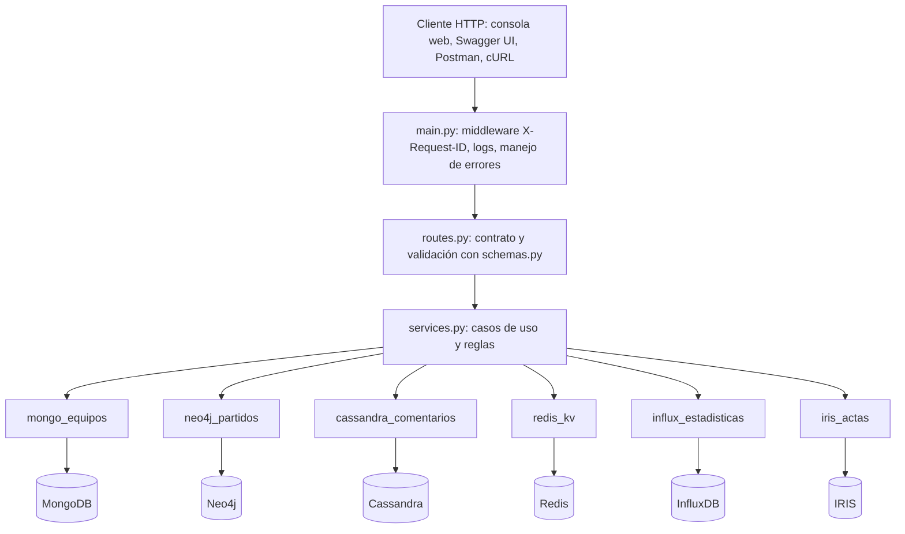

# Arquitectura y adaptadores

## Capas

| Capa | Responsabilidad | No hace |
| --- | --- | --- |
| `routes.py` | Declara rutas, parámetros con patrones/rangos, cuerpos (`schemas.py`), códigos documentados; arma `{data, meta}` | No conoce drivers ni reglas |
| `services.py` | Reglas: ventanas máximas, cursor, cache-aside, idempotencia, PUT sin cambios, distinción ausencia/vacío | No conoce HTTP ni drivers |
| `adapters/*` | Conexión, contexto (database/keyspace/namespace), consulta fija y parametrizada, transformación al modelo de la API, traducción de errores | No decide códigos HTTP ni reglas |
| `contexto.operacion()` | Mide, registra y traduce cada operación: errores del driver → `DependenciaNoDisponible` (503) | — |
| `main.py` | Ensambla, propaga `X-Request-ID`, convierte errores al formato común, ajusta OpenAPI, sirve la consola | — |

Los servicios reciben los adaptadores por constructor. Las pruebas unitarias reemplazan los seis por adaptadores en memoria sin cambiar rutas ni servicios.

## Adaptadores

| Adaptador | Conexión y contexto | Consulta | Transformación | Errores traducidos | Recursos |
| --- | --- | --- | --- | --- | --- |
| MongoDB (`pymongo`) | `MongoClient` con `authSource=admin`, base `MONGO_DB`; timeouts de selección, conexión y socket | `find`/`find_one`/`count_documents` con filtros fijos, proyección explícita, orden e índices del Hito 4 | Sin `_id`, `origen` ni marcas internas; fechas a ISO-8601 UTC | `PyMongoError` | Cliente perezoso y compartido (pool del driver) |
| Neo4j (`neo4j`) | `GraphDatabase.driver` bolt, base `NEO4J_DATABASE`, ruteo de lectura | Tres Cypher constantes con `$parametros` y `LIMIT`/slice | Proyecciones de mapa (`p {.partidoId, ...}`), `inicio` como texto UTC | `Neo4jError`, `DriverError`, `OSError` | Driver compartido; `max_transaction_retry_time` = timeout |
| Cassandra (`cassandra-driver`) | Conexión perezosa y reintentable, protocolo v5, DC `datacenter1`, `CONSISTENCY ONE` (nodo único) | Sentencias preparadas sobre `{keyspace}.comentarios_por_partido`; `fetch_size=None` por `IN + ORDER BY` | Fila → comentario; `creado_en` con milisegundos | `NoHostAvailable`, `DriverException`, `RequestExecutionException`, `OSError` | Una sesión compartida |
| Redis (`redis`) | Host/puerto/clave de `.env`, prefijo `fixture2030:h10`, sin reintentos internos | Lua de creación de sesión, `HGETALL`+`TTL` en transacción, `GET/SET EX/DEL`, `SET NX EX` | Hash → sesión pública (sin otros campos internos) | `RedisError`, `OSError` | Pool del cliente |
| InfluxDB (`httpx`) | `INFLUX_URL`, base `INFLUX_DB`, token en encabezado `Authorization` | `POST /api/v3/query_sql` con `params` (`$partido`, `$desde`, ...); intervalo de una lista cerrada | Columnas → nombres de la API, tiempos con `Z` | `httpx.HTTPError` (incluye 401/403/404/5xx); 400 = defecto propio → 500 | Cliente HTTP compartido |
| IRIS (`intersystems-irispython`) | `iris.connect` a namespace `USER`, usuario de mínimo privilegio | SQL DB-API con `?` sobre `FixtureH9.Partido`/`Evento`; API nativa para `CambiarEstado()` | IDs de IRIS conservados (`1`, `1\|\|1`), referencias resueltas con `->` | `RuntimeError` (enlace/credencial), `OSError`; error `5001` del dominio → 409 | Una conexión con lock; se reabre tras una falla |

El nombre de cada producto aparece solo en su adaptador, en la configuración y en las etiquetas de documentación. Los servicios hablan de equipos, partidos, comentarios, sesiones, estadísticas y actas.

## Decisiones

- **FastAPI**: genera OpenAPI y Swagger UI desde los mismos modelos que validan, lo que mantiene alineados contrato y comportamiento. Una prueba compara `openapi/openapi.yaml` con el esquema en vivo.
- **Endpoints sincrónicos**: los seis drivers son bloqueantes; FastAPI los ejecuta en su pool de hilos. Suficiente para el laboratorio.
- **Conexiones perezosas**: la API inicia aunque alguna fuente esté detenida y la reconecta cuando vuelve.
- **IRIS con lock global**: la conexión del driver no es segura entre hilos. Serializar es simple y correcto; con más concurrencia correspondería un pool (marcado con `ponytail:` en el código).
- **Regla de estado en IRIS**: la API no duplica la máquina de estados; invoca `Partido.CambiarEstado()` y traduce su error. Solo agrega la semántica idempotente del PUT (mismo estado → `cambio: false`).

## Respuestas a las preguntas guía

1. **Problema por endpoint**: ver la tabla de casos de uso (CU1 a CU15).
2. **Fuente por operación**: ver "Por qué cada fuente" en [casos_de_uso.md](casos_de_uso.md).
3. **Quién conoce el driver**: solo `app/adapters/*.py` (y `scripts/` de preparación). `services.py` y `routes.py` no importan drivers.
4. **Recurso inexistente**: 404 `RECURSO_NO_ENCONTRADO`; sesión ausente o vencida: 404 `SESION_NO_VIGENTE`.
5. **Base caída**: 503 `DEPENDENCIA_NO_DISPONIBLE` con `dependencia`, en a lo sumo el timeout configurado (≈1-3 s medidos).
6. **Vacío válido vs. error**: un vacío es 200 con lista vacía y `meta.fuentes[].resultado = "ok"`; una falla nunca es 200 (salvo la degradación explícita de la caché, marcada `BYPASS` y `error:...` en la traza).
7. **Validación previa**: patrones de IDs, enums, rangos de página/límite, fechas ISO, orden y amplitud de ventanas, cursor, cuerpo sin campos extra, `Idempotency-Key`. Ver [contratos_y_errores.md](contratos_y_errores.md).
8. **Límites**: página ≤ 50, plantel ≤ 50, agenda ≤ 20, eventos ≤ 50 (IRIS `TOP 100`), comentarios ≤ 50 por página con ventana ≤ 5 min, estadísticas ≤ 720 intervalos por equipo.
9. **Endpoints que modifican**: `POST comentarios` (crea), `POST sesiones` (crea), `DELETE sesiones` y `DELETE cache` (invalidan, idempotentes), `PUT actas/estado` (actualiza, idempotente), y `GET /equipos/{id}` que solo escribe caché.
10. **Reintentos de escritura**: `Idempotency-Key` obligatoria y reservada con `SET NX` antes de escribir; la repetición devuelve el original.
11. **Neo4j vs. Cassandra**: Neo4j parte de un nodo por ID y sigue relaciones (`OCURRE_EN`, `INVOLUCRA`); Cassandra no tiene relaciones: la API calcula qué particiones `(partido, minuto, segmento)` cubren la ventana y las lee por clave.
12. **Clave Redis inexistente vs. Redis caído**: la primera es una respuesta válida de Redis (`HGETALL` vacío) → 404; la segunda es una excepción del cliente → 503.
13. **Intervalo de InfluxDB**: `[desde, hasta)` en UTC, `hasta > desde`, hasta 720 intervalos de 10 s, 30 s, 1 min o 5 min por equipo; sin ventana, los últimos 10 minutos con datos dentro de la retención de 7 días.
14. **IRIS**: namespace `USER`, clases `FixtureH9.Partido`, `Evento`, `Arbitro` y `Jugador`.
15. **Hosts y puertos**: variables de entorno en `.env` ([conectividad_y_configuracion.md](conectividad_y_configuracion.md)).
16. **Logs**: ruta, método, estado, duración, requestId y por cada operación fuente, operación, resultado (tipo de excepción) y duración. No se registran cuerpos, query strings, tokens, URIs ni mensajes de excepción del driver.
17. **OpenAPI vs. comportamiento**: el contrato se genera de los modelos que validan; `test_openapi_versionado_coincide_con_la_aplicacion`, las pruebas de integración y la colección Postman verifican los códigos declarados.
18. **Dependencia lenta**: el timeout por operación (`DEP_TIMEOUT_SEGUNDOS`) acota la espera; se prueba con puertos sin servicio y con el contenedor detenido. Para lentitud real se podría usar `docker pause` sobre un contenedor y medir que la API responde 503 dentro del timeout.
19. **Qué cachear**: la ficha de equipo (cambia poco; riesgo: hasta 300 s de dato viejo, mitigado con la invalidación). Agenda y partido también serían cacheables; comentarios y estadísticas no, por su frescura.
20. **Límites del laboratorio**: un nodo por motor, un worker, conexión IRIS serializada, sin autenticación de consumidores, sin balanceo ni réplicas y mediciones de un único cliente secuencial.
