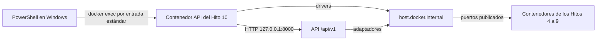

[Repositorio Fixture 2030 - Grupo 13](https://github.com/AxelYairFischbein/Fixture2030-Grupo13)

# Hito 11: evaluación de conectividad

El módulo evalúa las seis dependencias de la [API del Hito 10](../Hito%2010/README.md). Separa configuración, resolución del host, TCP, protocolo, autenticación, contexto, lectura y respuesta de la API. Reutiliza sus adaptadores y registros por dependencia. No agrega otro servicio ni carga datos.

## Preparación y ejecución en PowerShell

Se necesita Docker Desktop con contenedores Linux, Docker Compose y Python 3.10 o posterior en Windows. El lanzador utiliza solamente la biblioteca estándar. Los drivers y las versiones fijadas en [requirements.txt](../Hito%2010/requirements.txt) se ejecutan dentro de `grupo13-hito10-api-1`, con Python 3.12.

Los servicios de los Hitos 4 a 9 deben conservar su configuración y datos existentes. Si falta una credencial, tabla o muestra, se registra la limitación antes de prepararla. No se ejecuta la orquestación general ni una carga de muestras como prueba de conectividad.

Desde la raíz del repositorio:

```powershell
Set-Location '.\Hito 11'
docker version
docker compose -f '..\Hito 10\docker-compose.yml' config --quiet
docker compose -f '..\Hito 10\docker-compose.yml' up -d --build --no-deps api
docker compose -f '..\Hito 10\docker-compose.yml' ps api
python -X utf8 .\evaluar_conectividad.py
$LASTEXITCODE
```

El inicio actúa únicamente sobre la API. Necesita `Hito 10/.env` con las credenciales locales válidas de MongoDB, Neo4j e IRIS. InfluxDB utiliza el token local montado en `/run/influx/admin.token`. El ejemplo de variables está en [Hito 10/.env.example](../Hito%2010/.env.example). No se sobrescribe un `.env` existente ni se publica su contenido. Redis y Cassandra aceptaron las lecturas sin credenciales en este entorno.

El diagnóstico muestra solo host, puerto, contexto, presencia de credencial, versiones y tiempos de espera. No imprime los valores sensibles. No se debe guardar la salida completa de `docker inspect`, `env` o `docker compose config`, porque pueden contener secretos.

### Configuración y modos

[config/ejemplo.json](config/ejemplo.json) contiene únicamente parámetros no sensibles. Si se necesita otra selección, crear una copia local sin sobrescribirla:

```powershell
if (-not (Test-Path '.\config\local.json')) {
    Copy-Item '.\config\ejemplo.json' '.\config\local.json'
}
python -X utf8 .\evaluar_conectividad.py --config .\config\local.json
python -X utf8 .\evaluar_conectividad.py --modo tcp --producto redis
python -X utf8 .\evaluar_conectividad.py --modo clientes --producto iris
python -X utf8 .\evaluar_conectividad.py --modo api --producto mongodb
```

`completo` es el modo predeterminado y combina las tres capas. `tcp` verifica resolución y conexión. `clientes` utiliza los drivers del Hito 10 para el protocolo y la lectura. `api` llama a las rutas HTTP y exige sus logs correlacionados. Cada modo incluye la configuración. `--producto` acepta `mongodb`, `neo4j`, `cassandra`, `redis`, `influxdb` o `iris`. Omitirlo selecciona los seis. Una falla de otro producto no impide evaluar el seleccionado.

Para conservar una ejecución nueva, usar un nombre que todavía no exista:

```powershell
$marcaH11 = Get-Date -Format 'yyyyMMdd-HHmmss'
python -X utf8 .\evaluar_conectividad.py --salida ".\evidencia\conectividad-$marcaH11.md"
```

El programa no sobrescribe evidencias. `config/local.json`, `.env`, `.local`, entornos virtuales, tokens y cachés quedan excluidos mediante el [.gitignore](.gitignore). No agregar registros completos repetidos a la entrega.

## Topología y mapa de dependencias



El proceso que inicia las conexiones es Python dentro de la API, tanto para el diagnóstico directo como para sus endpoints. Se comprueba la configuración efectiva del contenedor, no solo el archivo de ejemplo. `localhost` dentro de la API identifica ese contenedor. En Windows identifica el equipo. `host.docker.internal` permite alcanzar los puertos publicados del equipo desde la API. Los servicios pertenecen a proyectos Compose separados.

La API publica `127.0.0.1:8000`. Los puertos de los Hitos 5 a 9 también se publican en loopback. MongoDB conserva la publicación existente de `27017` en todas las interfaces del equipo. El módulo de conectividad no cambia estas publicaciones.

| Producto y módulo | Host desde la API | Publicado → interno, protocolo | Contexto | Autenticación y cliente | Lectura mínima y ruta bajo `/api/v1` |
| --- | --- | --- | --- | --- | --- |
| MongoDB, equipos y jugadores | `host.docker.internal` | `27017 → 27017`, MongoDB wire | `fixture2030.equipos`, `jugadores` | Usuario y contraseña, `authSource=admin`, PyMongo | `find_one` de `EQ-001`. `GET /equipos?tamanio=3` |
| Neo4j, partidos | `host.docker.internal` | `7687 → 7687`, Bolt. Portal HTTP `7474 → 7474` | Database `neo4j` | Usuario y contraseña, driver `neo4j` | Partido `PAR-001` y hasta tres eventos con Cypher parametrizado. `GET /partidos/PAR-001?limiteEventos=3` |
| Cassandra, comentarios | `host.docker.internal` | `9042 → 9042`, CQL | `fixture2030_comentarios.comentarios_por_partido` | Sin credenciales en el adaptador local, `cassandra-driver` | Partido `PAR-001`, un minuto y cuatro segmentos, límite tres. `GET /partidos/PAR-001/comentarios` |
| Redis, sesiones y caché | `host.docker.internal` | `16379 → 6379`, RESP | Base 0, prefijo API `fixture2030:h10` | Sin contraseña configurada en el adaptador local, `redis` | `PING`, tipo, lectura acotada y TTL de la clave configurada. `GET /sesiones/SES-000000000000000000000000` |
| InfluxDB, estadísticas | `host.docker.internal` | `8181 → 8181`, HTTP | Database `fixture2030_h8`, tabla `estadisticas_equipo` | Token Bearer, `httpx` | SQL temporal y `DATE_BIN` de un minuto. `GET /partidos/PAR-001/estadisticas` con `equipoId=EQ-001` y ventana explícita |
| IRIS, actas | `host.docker.internal` | `1972 → 1972`, Superserver. Portal HTTP `52773 → 52773` | Namespace `USER`, clases `FixtureH9.Partido` y `FixtureH9.Evento` | Usuario `fixture_api` y contraseña, `intersystems-irispython` | Acta `PAR-001` por código y hasta 100 eventos del adaptador existente. `GET /actas/PAR-001` |

El puerto Redis utilizado es **16379**, no 6379 del equipo. El listado de equipos evita la ficha individual, que puede escribir caché. Las lecturas de sesiones no renuevan TTL. Cassandra conserva el patrón de partición del Hito 6. Su adaptador prepara sentencias al conectar, pero el diagnóstico solo ejecuta lecturas.

La ventana de comentarios es `[2030-06-10T18:00:00Z, 2030-06-10T18:01:00Z)`. InfluxDB consulta los últimos cinco minutos UTC completos si ambos límites son `null`. También se pueden fijar ambos instantes en el JSON. No se modifican los puntos ni se generan fechas para obtener resultados. Los filtros utilizados son `partido_id`, `equipo_id` y `time`. No se agrega un filtro por estadio.

## Qué demuestra cada capa

| Capa | Alcance y límite |
| --- | --- |
| Configuración | Muestra el destino y las versiones cargadas. Tener una credencial configurada no prueba que sea válida. |
| DNS y TCP | Demuestran resolución y aceptación de conexión desde la API. No prueban protocolo, identidad ni permisos. |
| HTTP auxiliar | Distingue el portal de Neo4j o IRIS del acceso a datos. En InfluxDB, el health sin token y el autorizado son pruebas separadas. |
| Driver y contexto | Un ping o `SELECT 1` comprueba el protocolo y el contexto configurado. La lectura posterior verifica la colección, tabla o entidad utilizada. |
| Autenticación | Identidad de la conexión. MongoDB consulta `connectionStatus` y Neo4j `SHOW CURRENT USER`, contrastando la identidad configurada sin imprimirla. Redis consulta `ACL WHOAMI`, pero sin credencial configurada no acredita autenticación por contraseña. Cassandra, InfluxDB e IRIS quedan como no verificada independientemente. |
| Autorización | Permiso para una operación y recurso concretos. MongoDB inspecciona el privilegio `find` sobre la colección `equipos`. Redis utiliza `ACL DRYRUN` para `GET` sobre la clave configurada sin ejecutar esa lectura. Los otros productos quedan como no verificada independientemente. No se evalúan escrituras. |
| API y logs | Comprueban ruta, validación, adaptador, respuesta y correlación con `X-Request-ID`. La validación 400 sucede antes de consultar una dependencia. |

La clave `fixture2030:h11:demo:conectividad` puede estar ausente. `TTL=-2` indica ausencia, sin permitir afirmar si venció o nunca existió. `TTL=-1` significa que una clave existente no tiene vencimiento. Una ventana vacía de InfluxDB es válida si la consulta fue aceptada. Ninguno de estos resultados demuestra una caída.

Los adaptadores usan `DEP_TIMEOUT_SEGUNDOS=3` para sus esperas de red. IRIS limita también el cursor SQL a tres segundos. No es un plazo total de todo el request, que puede incluir varias operaciones. Redis no reintenta internamente y Neo4j limita su ventana de reintentos a ese tiempo. El diagnóstico usa TCP de 3 s, HTTP de 8 s y un supervisor de 20 s por etapa dentro de la API. Al vencer este último termina únicamente su proceso de prueba, sin declarar que la base cayó. La llamada a Docker tiene 10 s adicionales. No hay bucles de reintentos en el diagnóstico.

## Estados, fallas y salud

La matriz separa **estado observado** y **evaluación completa o incompleta del modo solicitado**. Una lectura exitosa no convierte en realizadas las etapas omitidas. Los modos `clientes` y `completo` incluyen la verificación independiente de identidad y permisos. Una inspección no disponible se registra como `WARN`, con evaluación incompleta, sin declarar caída de la dependencia. No se cambian usuarios ni permisos para obtener acceso a esa inspección. La ausencia de credenciales en el adaptador no demuestra que la autenticación del servidor esté deshabilitada.

| Estado | Interpretación |
| --- | --- |
| Disponible | Se completó una lectura o un endpoint con resultado válido, incluso una ausencia válida. |
| No disponible | Se observó una falla de acceso o uso y no hubo un acceso exitoso en esa evaluación. No implica necesariamente que el proceso del servidor esté apagado. |
| Degradado | Hubo operaciones exitosas y fallas de acceso o uso al mismo producto. |
| No probado | Solo se obtuvo configuración o las pruebas quedaron omitidas. |
| Desconocido | La evidencia es insuficiente, por ejemplo TCP sin lectura o un fallo del propio diagnóstico. |

`OK` acredita únicamente la operación indicada. `WARN` señala una limitación como ausencia de muestra o acceso sin credenciales. `FAIL` indica que una prueba falló, pero su causa puede ser el proceso de diagnóstico. `SKIP` indica una prueba no completada, no una caída.

El código de salida es **0** cuando las etapas solicitadas terminaron sin `FAIL`, **1** cuando terminaron con fallas y **2** cuando falta alguna etapa, verificación independiente, herramienta o correlación. El 2 tiene prioridad. Un aviso de muestra ausente no vuelve incompleta una lectura realizada. Un modo TCP completo puede devolver 0 con estado desconocido, porque no incluyó una lectura.

| Señal observada | Hipótesis y siguiente paso |
| --- | --- |
| Host no resuelto | Revisar nombre y red desde la API. No cambiar credenciales para resolver un error DNS. |
| Conexión rechazada | Comprobar listener, puerto publicado y estado del contenedor exacto. |
| Timeout identificable | Contrastar TCP y driver, revisar ruta y carga. No aumentar plazos sin diagnosticar. |
| Rechazo de autenticación o permisos | Revisar la credencial local o los permisos mínimos de lectura sin imprimirlos. |
| Contexto inexistente o consulta inválida | Revisar database, esquema y consulta fija. No cargar datos automáticamente. |
| Error sin causa tipada, del script o herramienta | Conservar el tipo seguro y registrar incertidumbre. Revisar configuración y código antes de atribuir la falla a la base. |
| Logs ausentes o parciales | Evaluación incompleta. Revisar acceso a `docker logs` y configuración de logging. No cambia por sí solo el estado de la base. |

La API distingue 200 con lista vacía, 404 por recurso o sesión ausente, 400 por validación, 503 por falla de acceso identificada, 504 por timeout identificable y 500 por error interno. Un `RuntimeError` de IRIS no se clasifica automáticamente como timeout. Los tipos y códigos reconocidos se verifican con pruebas unitarias. Las respuestas conservan mensajes públicos seguros y `X-Request-ID`. Los logs registran operación, dependencia, tipo de falla y duración, sin mensajes crudos del driver ni trazas sensibles. El contrato está en [OpenAPI](../Hito%2010/openapi/openapi.yaml).

### Liveness, readiness y diagnóstico

**Implementado:** `/api/v1/salud` ejecuta secuencialmente el `ping()` de los seis adaptadores. Devuelve 200 si todos responden y 503 agregado si alguno produce una falla de dependencia, incluidos los timeouts. Sus detalles informan cada fuente y duración. No comprueba todas las tablas ni la existencia de datos del dominio. Un error interno inesperado sigue siendo 500.

Ese endpoint es un diagnóstico profundo, no una prueba aislada de liveness del proceso. Tampoco demuestra que todos los casos de uso estén listos. Tiene el costo de seis operaciones de fuente más sus conexiones y posibles reintentos acotados. Se utiliza explícitamente al iniciar o investigar una incidencia, no en cada request normal ni en un bucle continuo. El procedimiento por producto evita exigir las seis bases para una sola comprobación.

**Propuesta, no implementada:** separar una comprobación de liveness que solo evalúe el proceso y una readiness por caso de uso con las dependencias realmente necesarias. La frecuencia debe ajustarse al costo y al tiempo de recuperación esperado. No se agregaron endpoints, tareas programadas ni failover.

### Redis y memoria

La política observada es `noeviction`, con `maxmemory=64mb` en el Compose del Hito 7. Al alcanzar el límite, Redis no elimina claves para admitir nuevas escrituras. Puede rechazar la creación de sesiones y las escrituras de caché. La API informa la falla de sesión, sin autorizar un acceso que no pudo validarse. Para la ficha cacheada conserva la lectura desde MongoDB y marca `BYPASS`, con el costo adicional de consultar el origen. Una clave que vence por TTL sí puede desaparecer. No se ejecutó una prueba de saturación ni se alteró la política.

## Prueba controlada de recuperación

La prueba afecta solo a `grupo13-hito7-redis-1`, proyecto `grupo13-hito7`, compartido por los Hitos 7 y 10. Publica `127.0.0.1:16379` y conserva `grupo13_hito7_redis_data` montado en `/data`. Requiere autorización del responsable del entorno antes de detenerlo. No debe detenerse otro Redis ni reiniciarse la API. Revisar los clientes conectados y los requests recientes antes de proceder. Si hay indicios de uso por otra persona, coordinar el corte antes de continuar.

**Resultado real del 22 de octubre de 2026:** el mismo GET devolvió `404 SESION_NO_VIGENTE` antes, `503 DEPENDENCIA_NO_DISPONIBLE` durante el corte y nuevamente `404 SESION_NO_VIGENTE` después. Los tres requests tuvieron logs correlacionados. Durante el corte se registró `ConnectionError`. Redis volvió a responder `PONG` y la API recuperó el acceso. Se conservaron la identidad del contenedor y el volumen. El recuento de claves fue cero antes y después, por lo que no se comprobó la recuperación de un valor persistido. La [evidencia de recuperación](evidencia/02_recuperacion.txt) conserva los tiempos, identificadores y resultados observados.

El procedimiento compara exactamente el mismo GET antes, durante y después. Desde `Hito 11`, comprobar primero el contenedor y su montaje sin mostrar variables:

```powershell
$redisH11 = docker inspect grupo13-hito7-redis-1 | ConvertFrom-Json
$redisH11.Name
$redisH11.Config.Labels.'com.docker.compose.project'
$redisH11.State.Status
$redisH11.Mounts | Where-Object Destination -eq '/data' | Select-Object Type, Name, Destination
```

Solo si estaba activo, coincide con lo indicado y el corte está autorizado, ejecutar en una consola que permanezca abierta. El bloque `finally` vuelve a iniciar el mismo contenedor incluso si una comprobación falla. Elegir otro archivo si ya existe una evidencia de recuperación:

```powershell
if (-not $redisH11.State.Running) { throw 'El servicio debe estar activo antes de la prueba' }
if ($redisH11.Config.Labels.'com.docker.compose.project' -ne 'grupo13-hito7') { throw 'Proyecto distinto' }
$montajeH11 = @($redisH11.Mounts | Where-Object Destination -eq '/data')
if ($montajeH11.Count -ne 1 -or $montajeH11[0].Type -ne 'volume' -or $montajeH11[0].Name -ne 'grupo13_hito7_redis_data') {
    throw 'Montaje distinto al autorizado'
}
if ($redisH11.NetworkSettings.Ports.'6379/tcp'[0].HostPort -ne '16379') { throw 'Puerto distinto' }
if (Test-Path '.\evidencia\02_recuperacion.txt') { throw 'Conservar la evidencia existente' }
& {
    Get-Date -Format o
    'ANTES'
    python -X utf8 .\evaluar_conectividad.py --modo api --producto redis
    if ($LASTEXITCODE -ne 0) { throw 'Resolver la prueba de referencia antes del corte' }
    try {
        docker stop --time 10 grupo13-hito7-redis-1
        if ($LASTEXITCODE -ne 0) { throw 'No se pudo detener el contenedor autorizado' }
        'DURANTE'
        python -X utf8 .\evaluar_conectividad.py --modo api --producto redis
    } finally {
        docker start grupo13-hito7-redis-1
        if ($LASTEXITCODE -ne 0) { throw 'La recuperacion requiere intervencion inmediata' }
        $esperaH11 = [System.Diagnostics.Stopwatch]::StartNew()
        do {
            $pingH11 = docker exec grupo13-hito7-redis-1 redis-cli --raw PING
            if ($LASTEXITCODE -eq 0 -and $pingH11 -eq 'PONG') { break }
            Start-Sleep -Milliseconds 500
        } while ($esperaH11.Elapsed.TotalSeconds -lt 30)
        $esperaH11.Stop()
        if ($pingH11 -ne 'PONG') { throw 'Redis no respondio dentro de 30 segundos' }
    }
    Start-Sleep -Seconds 1
    'DESPUES'
    python -X utf8 .\evaluar_conectividad.py --modo api --producto redis
    docker inspect --format '{{.State.Status}}' grupo13-hito7-redis-1
    $finalH11 = docker inspect grupo13-hito7-redis-1 | ConvertFrom-Json
    'Mismo contenedor: ' + ($finalH11.Id -eq $redisH11.Id)
    $finalH11.Mounts | Where-Object Destination -eq '/data' | Select-Object Type, Name, Destination
} | Tee-Object -FilePath '.\evidencia\02_recuperacion.txt'
```

Con la sesión de ejemplo ausente se espera 404 antes y después, y 503 o 504 durante el corte según la falla observada. El script conserva duración, request ID y logs. Un código 2 exige resolver la evidencia faltante antes de dar la prueba por válida. Si vence el plazo de disponibilidad, conservar el registro de la falla y revisar el servicio. Comparar contenedor y volumen demuestra que no se reemplazaron. Si no había claves con datos, no se puede afirmar que se verificó la recuperación de un valor persistido. No se debe crear una muestra para ocultar esa limitación. Para una nueva evidencia, anteponer un resumen de hasta 25 líneas derivado de las salidas reales, conservando el detalle debajo.

## Evidencia, pruebas y limitaciones

| Archivo | Contenido |
| --- | --- |
| [evaluar_conectividad.py](evaluar_conectividad.py) | Lanzador y funciones por capa, con ejecución de drivers dentro de la API |
| [config/ejemplo.json](config/ejemplo.json) | Destinos lógicos, ventanas, límites y plazos sin secretos |
| [tests/test_diagnostico.py](tests/test_diagnostico.py) | Pruebas unitarias de clasificación, identidad, permisos y logs, sin bases ni Docker |
| [evidencia/01_conectividad.md](evidencia/01_conectividad.md) | Ejecución histórica del 21 de octubre de 2026 a las 21:56:28, UTC−03:00, matriz y logs |
| [evidencia/02_recuperacion.txt](evidencia/02_recuperacion.txt) | Corte y recuperación de Redis del 22 de octubre de 2026, con resumen inicial de 24 líneas y detalle de los tres requests |
| [evidencia/03_conectividad.png](evidencia/03_conectividad.png) | Captura del encabezado y la matriz de la ejecución registrada el 21 de octubre de 2026 |
| [evidencia/04_recuperacion.png](evidencia/04_recuperacion.png) | Captura del resumen de recuperación del 22 de octubre de 2026, con respuestas, logs y estado final de Redis |

La ejecución registrada utilizó Docker Engine 29.7.2, Python 3.12.15 en la API y los drivers informados en cada producto. Su versión del diagnóstico registró 67 `OK`, 3 `WARN`, ningún `FAIL` ni `SKIP` y salida 0. Es evidencia de acceso funcional a las seis dependencias, no de verificación independiente de autenticación y autorización. Esas filas se inferían de operaciones aceptadas. Se conservan sus resultados y fechas como registro histórico. La versión actual exige las comprobaciones separadas descritas arriba y puede devolver 2 aun con una lectura exitosa. Los avisos históricos corresponden al acceso sin credenciales de Cassandra y Redis y a la clave Redis ausente. InfluxDB devolvió una ventana vacía válida. No se infirió una expiración ni se cargaron datos nuevos.

También pasaron tres pruebas unitarias del diagnóstico y las 22 pruebas de `tests/unit` del Hito 10 dentro de la imagen de la API. Las pruebas con dobles verifican 503, 504, 500, fallback, privacidad y contrato OpenAPI. No prueban una conexión real. Una prueba existente usa el driver Redis contra un puerto local sin servicio, sin escribir datos. No se ejecutaron las pruebas de integración con escrituras. El Compose se validó con `config --quiet`.

En ejecuciones separadas a las 22:00:55, UTC−03:00, se comprobaron los comandos de selección: TCP para Redis, clientes para IRIS y API para MongoDB. Los tres finalizaron con salida 0. TCP conservó correctamente el estado desconocido porque no incluyó una lectura. Estas comprobaciones no se suman a los contadores de la evidencia completa.

Para repetir las pruebas unitarias desde esta carpeta:

```powershell
python -X utf8 -m unittest discover -s .\tests -v
docker compose -f '..\Hito 10\docker-compose.yml' exec -T api python -m pytest tests/unit -q -p no:cacheprovider
```

Los cambios del Hito 10 se limitan a la clasificación de errores, los logs seguros, el plazo del cursor IRIS, el contrato y sus pruebas. Las lecturas reales comprobaron esos adaptadores. No se verificaron fallas reales de autenticación, permisos, contexto o lentitud en los seis productos. Su clasificación se aplica solo cuando el driver aporta evidencia suficiente.

La prueba del 22 de octubre completa el escenario real de RF20 y RF21. Ese día también pasaron nuevamente las tres pruebas unitarias del diagnóstico. No se modificaron el diagnóstico ni la API para la prueba de recuperación. La evidencia completa del día anterior se conserva como una ejecución distinta, sin afirmar que se repitieron las seis dependencias el día 22.

Los resultados de conectividad no representan una garantía de disponibilidad permanente ni una medición de rendimiento.

El 29 de octubre de 2026 se comprobó la separación de identidad y permisos con lecturas reales de MongoDB, Neo4j, Cassandra e IRIS. MongoDB confirmó ambas verificaciones. Neo4j confirmó identidad, mientras que los otros permisos quedaron como no verificados independientemente. Cassandra e IRIS conservaron disponibilidad observada con cobertura incompleta. Redis e InfluxDB estaban detenidos y no se repitieron sus comprobaciones reales. Pasaron seis pruebas unitarias del diagnóstico. El [registro de estas comprobaciones](../Hito%2012/evidencia/07_validacion.txt) conserva el alcance y las fechas, separado de las evidencias históricas.

### Capturas

Las dos imágenes muestran las ejecuciones registradas en los archivos de texto, no pruebas nuevas. La primera conserva el contexto y el estado de las seis dependencias. La segunda muestra la secuencia 404, 503 y 404, sus logs correlacionados y la conservación del contenedor y el volumen. No contienen credenciales ni tokens.
